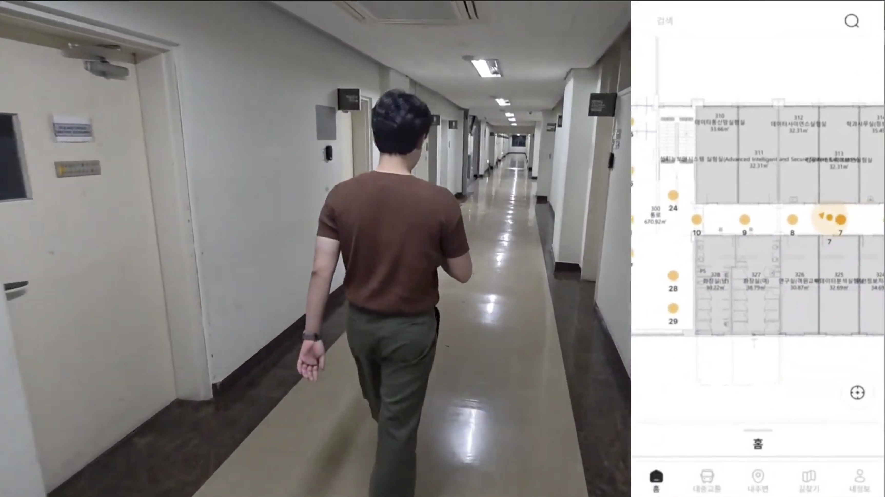
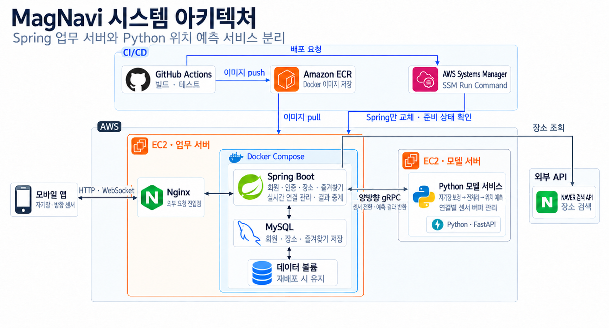
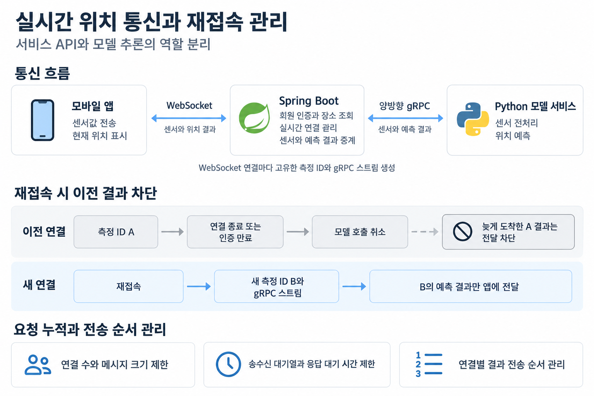
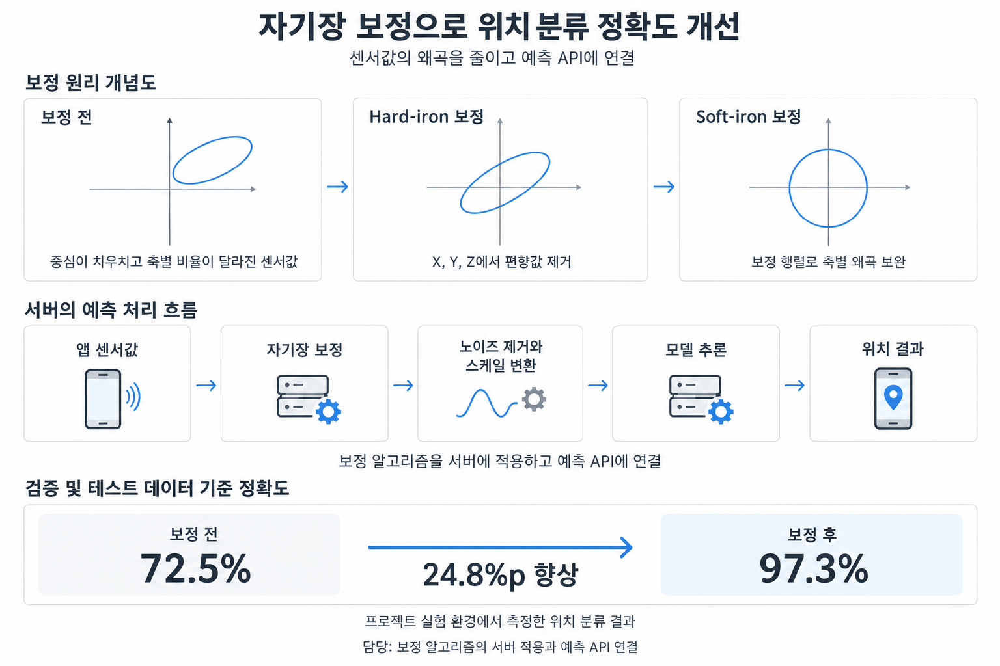
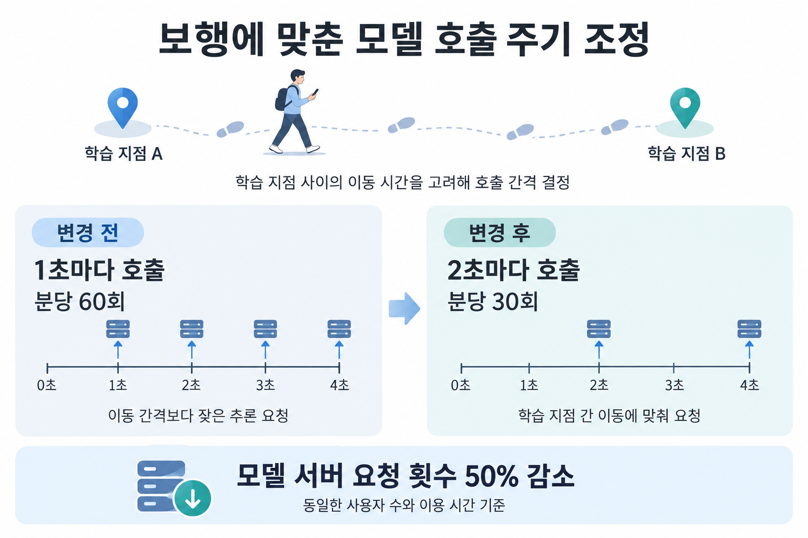

# MagNavi Positioning Service

**센서 전처리·위치 추론과 측정별 gRPC 스트림을 담당하는 Python 백엔드입니다.**

MagNavi는 GPS로 위치를 파악하기 어려운 실내에서 자기장·방향 센서와 딥러닝으로 위치를 구분하는 프로젝트입니다. 미리 측정한 공간의 자기장 패턴을 학습해 별도의 비콘 장비 없이 동작하는 프로토타입을 개발했습니다. 이 저장소는 **센서 전처리·위치 예측과 측정별 모델 상태 관리**를 담당하고, Spring 서버는 **회원·인증·장소·즐겨찾기와 앱의 실시간 연결 관리**를 담당합니다.

- **2025.02~2025.11:** 6명 팀 프로젝트 — 프론트엔드 3명·백엔드 3명, 팀장 및 서버·DB·AWS 인프라 담당.
- **2026.09~현재:** 백엔드 개인 고도화 — Spring 업무 API와 Python 모델 서비스의 역할 분리, 스트리밍 연동과 회귀 검증 진행.
- **이 저장소의 주요 구현:** 자기장 보정·16개 센서 윈도우·MLP 추론, 측정별 버퍼 격리, 모델 준비 상태 검증, 한도를 둔 gRPC 계산·취소·재접속 처리.
- **주요 결과:** 프로젝트 실험의 위치 분류 정확도 72.5% → 97.3%, 기존 HTTP 예측 요청 주기 1초 → 2초, WebSocket–gRPC 연결별 격리·취소·재접속 처리 구현.

[시연 영상](https://www.youtube.com/watch?v=kqR17mF1d1U) · [개발자 포트폴리오](https://app.notion.com/p/400dedc0d781803fb123c5aafc50e8b4) · [Spring 저장소](https://github.com/MagNavi-server/magnavi-api-service) · [논문 정보](https://www.dbpia.co.kr/journal/articleDetail?nodeId=NODE12567180)

[](https://www.youtube.com/watch?v=kqR17mF1d1U)

*포트폴리오에 수록된 기존 앱 시연 화면입니다. 현재 Spring WebSocket v2로 전환한 앱의 시연 결과는 아닙니다.*

[아키텍처](#architecture) · [모델 기능](#features) · [실시간 통신](#realtime) · [자기장 보정](#calibration) · [호출 주기 개선](#interval) · [트러블슈팅](#troubleshooting) · [검증](#validation) · [실행·문서](#documents)

<a id="architecture"></a>
## 1. 시스템 아키텍처와 기술 선택



그림은 포트폴리오의 전체 구성도입니다. Spring의 업무 API·실시간 중계와 Python의 모델 계산을 분리했고, 두 서버 사이의 로컬 통신은 실제 모델로 검증했습니다. **그림에 표시된 앱 전환·운영 모델 연결·HTTPS/WSS까지 모두 검증한 상태는 아닙니다.** 확인한 자동 배포는 Spring 교체와 readiness 상태 확인이며, Python gRPC 서버의 운영 배포는 후속 작업입니다.

| 구성 | 역할과 선택 이유 |
|---|---|
| Python · NumPy · PyWavelets | 기존 학습 모델의 전처리 순서를 유지하며 자기장 보정·최근 센서 윈도우·웨이브렛 잡음 완화를 수행합니다. |
| scikit-learn · MLP | 스케일러로 6개 입력 특성을 변환한 뒤 학습된 위치 라벨과 후보 점수를 계산합니다. 모델·스케일러·인코더·보정·전처리 파일을 하나의 묶음으로 검증합니다. |
| gRPC AsyncIO · Protobuf | Spring으로부터 센서를 연속 수신하고 같은 스트림으로 결과를 반환합니다. 메시지 계약을 공유하고 측정마다 독립 세션을 만듭니다. |
| ThreadPoolExecutor | 동기 모델 계산을 비동기 통신 처리와 분리합니다. 작업자 수와 대기 작업 수를 제한하며 취소 후에도 실행 중인 계산의 자원을 추적합니다. |
| FastAPI | 기존 HTTP 예측·업무 API를 전환 기간 동안 유지합니다. 새 gRPC 서버는 업무 DB 없이 별도 진입점으로 실행할 수 있습니다. |
| Spring · JWT · JPA · MySQL | 회원·인증·장소·즐겨찾기와 모델 코드의 장소 매핑을 담당하는 연동 서버입니다. 앱의 WebSocket 연결도 Spring에서 관리합니다. |
| Docker · GitHub Actions · AWS | Spring 저장소에 빌드·검증·배포 흐름을 구현했습니다. Python의 컨테이너 배포와 운영 모델 연결까지 완료한 상태는 아닙니다. |

Python은 **공유하는 모델 묶음**과 **측정마다 달라지는 센서 이력**을 분리했습니다. 모델 로딩·검증은 시작 단계에서 수행하고, 각 gRPC 스트림이 자신의 센서 버퍼와 종료 상태를 관리합니다. 같은 회원이 재접속해도 이전 측정의 버퍼를 이어받지 않습니다.

```text
magnavi-positioning-service/
├── services/       # 모델 로딩·준비 상태·전처리·추론·측정 세션
├── positioning/    # gRPC 서버·순서 검증·계산 작업자·독립 실행
├── contracts/      # Spring Protobuf 계약 사본·출처·해시
├── config/         # 로컬 합성 검증용 모델 등록값·자원 한도
├── model/          # 학습 모델·스케일러·인코더·보정·전처리 파일
├── routers/        # 상태 확인·기존 HTTP API
├── tests/          # 기준 결과·세션·모델 수명·계약·실제 gRPC 검증
└── tools/grpc/     # 통신 코드 생성·계약 검사
```

[모델 처리 구조](PROJECT_OVERVIEW.md#2-현재-코드와-모델-처리) · [gRPC 계약](docs/api/GRPC_CONTRACT.md) · [실행 의존성](requirements-streaming.txt)

### 업무 API와 모델 서버를 나눈 과정

- 기존 Python 서버는 회원·장소·즐겨찾기와 모델 추론을 함께 처리했습니다. Spring에 업무 API·인증·DB 기반을 만들면서 Python은 센서 전처리와 위치 예측을 독립 실행할 수 있도록 정리했습니다.
- 기존 모델의 결과를 먼저 고정한 뒤 센서 버퍼를 측정별로 분리하고, 모델 준비·입력 오류 처리를 보완한 다음 gRPC 스트림을 연결했습니다. 단계마다 같은 합성 입력의 결과가 유지되는지 비교했습니다.
- Spring은 로그인한 사용자를 확인하고 모델의 위치 코드를 장소 정보로 변환합니다. Python은 학습된 위치 코드와 후보 점수를 반환하며 회원·장소 DB를 직접 조회하지 않고 gRPC 추론을 수행합니다.
- 기존 Python 업무 API·DB 의존과 HTTP 예측 호환 경로는 남아 있습니다. 모바일 앱과 데이터 전환을 확인한 뒤 제거할 대상입니다.

Spring의 자동 배포는 검증한 이미지를 ECR에 올리고 SSM으로 EC2의 Spring만 교체해 MySQL과 볼륨을 유지합니다. 전체 서비스의 배포 흐름은 [Spring CI·배포 문서](https://github.com/MagNavi-server/magnavi-api-service/blob/develop/docs/CI_CD.md)에 정리했습니다.

<a id="features"></a>
## 2. Python에 구현한 모델 처리

기존 계산을 바로 바꾸기보다 합성 입력 144개의 위치 코드·후보·점수를 기준으로 보존했습니다. 이 기준과 비교하면서 전처리 순서를 유지하고, 공유 모델과 측정 상태를 분리한 뒤 준비 실패·잘못된 입력·연결 종료를 처리했습니다.

### 센서 전처리·추론: 학습에 사용한 입력 순서 유지

- 자기장 `Mag_X`·`Mag_Y`·`Mag_Z`와 방향 `Ori_X`·`Ori_Y`·`Ori_Z`를 받습니다. 누락과 NaN·무한대를 검사하고 공용 추론 진입점에서도 다시 확인합니다.
- 자기장에 편향·보정 행렬을 적용한 뒤 해당 측정의 최근 **16개 자기장 샘플**을 갱신합니다. 웨이브렛으로 잡음을 완화하고 각 축의 마지막 값을 사용합니다.
- 전처리한 자기장 3개와 **현재 입력의 방향 3개**를 결합합니다. 방향값에도 같은 시간 필터를 임의로 적용하지 않고, 저장된 스케일러와 MLP 모델을 순서대로 실행합니다.
- 예측 라벨을 위치 코드로 변환합니다. 후보 라벨의 점수 순서에서 중복 위치를 제거하고 최대 3개의 위치 후보를 선택합니다. gRPC 응답에서는 등록된 코드와 유한한 점수를 확인합니다.
- 초기 샘플이 16개보다 적으면 마지막 값으로 채우는 `pad` 정책으로 첫 입력부터 예측합니다. 초기 응답을 기다리게 하려고 기존 모델 계산을 바꾸지 않았습니다.

[전처리·추론 코드](services/model_service.py) · [기존 결과 비교 기준](tests/baseline/README.md)

### 모델 준비: 파일 로딩과 요청 처리 가능 상태 구분

- 모델 모듈을 불러오는 즉시 파일을 읽던 구조를 명시적인 시작 단계로 옮겼습니다. 모델·스케일러·인코더·편향·보정 행렬·전처리 설정 **6개 파일**을 함께 확인합니다.
- 입력 차원·보정 행렬·클래스 순서·전처리 설정을 검증하고, 별도의 합성 세션에서 시험 추론한 뒤 준비 완료 상태를 공개합니다. gRPC 시작 시에는 등록한 모델 파일 해시와 모델·센서 프로필도 검사합니다.
- 파일이 없거나 구조·시험 추론이 잘못되면 시작을 실패로 처리합니다. 실패를 출력만 하고 요청을 계속 받지 않도록 했습니다.
- FastAPI의 `/health/live`는 HTTP 응답 가능 여부를 나타냅니다. `/health/ready`는 모델과 gRPC 서버가 모두 준비된 경우에만 200을 반환하며, 미준비·종료 상태에서는 503을 반환합니다.

[로딩 검증](services/model_loader.py) · [런타임 상태](services/model_runtime.py) · [준비 상태·입력 오류 처리](docs/troubleshooting/model-readiness-and-input-validation.md)

### 측정 세션: 버퍼·실패 복구·종료를 한 단위로 관리

- gRPC 스트림마다 `PredictionSession`을 만들어 자기장 3축 버퍼를 분리합니다. 공유 모델을 사용하더라도 다른 측정의 센서 이력이 섞이지 않게 했습니다.
- 같은 세션의 계산은 순서대로 실행합니다. 버퍼 갱신 이후 계산이 실패하면 이전 윈도우로 복구하고, 그 사이 종료됐다면 버퍼를 비운 상태로 유지합니다.
- 종료한 세션은 후속 입력과 늦은 계산 결과를 거절합니다. 재접속은 새로운 세션을 만들며 이전 세션 객체를 재사용하지 않습니다.
- 기존 HTTP `/predict`에는 측정 식별자가 없어 호환 경로의 공유 세션이 남아 있습니다. **측정별 격리는 새 gRPC 경로에 적용되어 있으며, 기존 HTTP의 사용자 격리까지 완료한 것은 아닙니다.**

[측정 세션 코드](services/prediction_session.py) · [세션 분리 과정과 검증](docs/troubleshooting/session-buffer-isolation.md)

회원가입·로그인·본인 정보, 건물·층·장소 조회, 모델 코드 매핑, 네이버 지역 검색과 본인 즐겨찾기는 Spring에 구현했습니다. 두 서버가 제공하는 기능은 [Spring 업무 기능 설명](https://github.com/MagNavi-server/magnavi-api-service#features)에서 함께 확인할 수 있습니다.

<a id="realtime"></a>
## 3. WebSocket·gRPC 실시간 통신과 재접속 관리



위치를 계속 갱신하려면 통신 연결을 유지해야 합니다. 그런데 같은 회원이라는 이유로 이전 연결의 결과를 새 연결에 보내면, 재접속 직후 과거 위치가 현재 위치를 덮어쓸 수 있습니다. 이를 막기 위해 **회원과 측정을 구분하고, 한 WebSocket 연결을 하나의 측정으로 관리**했습니다. Python에서는 연결된 gRPC 스트림마다 센서 버퍼와 계산 상태를 분리합니다.

### 연결부터 결과 전달까지

1. **인증:** Spring이 `/ws/positioning`의 Bearer JWT를 확인하고 앱의 실시간 연결을 관리합니다. Python은 Spring으로부터 모델 추론 요청을 받습니다.
2. **측정 시작:** Python이 `start`의 새 측정 ID·계약 버전·모델·센서 프로필을 확인합니다. 준비된 모델로 세션을 만든 뒤 `ready`를 반환하며, 사용 중인 측정 ID의 중복 시작은 거절합니다.
3. **센서 처리:** `sequence`는 1부터 하나씩 증가하고 경과 시간은 첫 입력 0 이후 증가해야 합니다. 6개 센서의 누락·비유한 값·잘못된 순서를 검사한 뒤 해당 세션에서 전처리·추론합니다.
4. **결과 전달:** Python은 입력의 순번에 대응하는 위치 코드·후보·점수를 같은 gRPC 스트림에 반환합니다. Spring이 최상위 코드를 장소 정보에 연결하고 앱의 같은 WebSocket으로 전달합니다.
5. **종료·재접속:** 앱 종료·시간 초과에 따른 Spring의 취소를 Python까지 전달합니다. 해당 세션을 닫고 늦은 결과를 버리며, 재접속은 새 ID·새 스트림·빈 버퍼로 시작합니다.

### 느린 계산 때문에 요청이 계속 쌓이지 않도록 제한

- 한 스트림에서 입력 수신 → 계산 → 결과 송신을 순서대로 처리합니다. 결과를 보내기 전 다음 입력을 계속 계산 대기열에 쌓지 않습니다.
- 동기 모델 계산은 제한된 작업자에서 수행하고, 동시에 제출할 수 있는 작업 수를 `workers + pending_jobs`로 제한합니다. 비동기 통신을 사용했다는 사실만으로 계산 속도 향상을 주장하지 않습니다.
- 취소된 대기 작업은 취소하고, 이미 실행 중인 계산은 완료될 때까지 슬롯을 유지합니다. 계산이 뒤늦게 끝나더라도 종료한 측정이나 재접속한 측정에 전달하지 않습니다.
- 시작·입력 유휴·계산·결과 송신의 대기 시간을 각각 제한합니다. 센서 원본과 상세 예측 이력은 DB와 운영 기본 로그에 남기지 않습니다.

| Python gRPC 설정 | 현재 기본값 |
|---|---|
| 바인딩 주소 / 포트 | `127.0.0.1:50051` — 로컬 검증용 |
| 계산 작업자 / 추가 대기 작업 / 동시 스트림 | 1개 / 8개 / 8개 |
| 메시지 크기 | 65,536바이트 |
| 시작 / 입력 유휴 / 계산 / 송신 대기 | 3초 / 30초 / 5초 / 5초 |

위 값은 개발 단계의 제한값이며 실측한 처리량 보장 수치는 아닙니다. 현재 진입점은 루프백 주소만 허용합니다. 실제 모바일의 센서 단위·축·전송 주기와 운영 통신·부하를 확인한 뒤 전환해야 합니다. 실행 중인 스레드 계산 자체를 강제로 중단하지는 못하므로, 영구 정지한 계산의 종료 시간 상한은 별도 과제입니다.

[gRPC 계약·오류·한도](docs/api/GRPC_CONTRACT.md) · [로컬 설정](config/positioning.synthetic.json) · [구현 PR #6](https://github.com/MagNavi-server/magnavi-positioning-service/pull/6) · [Spring WebSocket 계약](https://github.com/MagNavi-server/magnavi-api-service/blob/develop/docs/api/POSITIONING_WEBSOCKET.md)

<a id="calibration"></a>
## 4. 자기장 보정으로 위치 분류 정확도 개선



초기 프로젝트에서 위치 분류 정확도가 정체되어 센서값과 전처리 과정을 점검했습니다. 관련 논문을 검토하며 스마트폰의 자성 부품과 센서 특성에 따른 편향·축별 왜곡이 입력에 영향을 줄 수 있음을 확인했고, 이를 보완하는 보정 알고리즘을 예측 API에 적용했습니다.

- **Hard-iron 보정:** 자기장 X·Y·Z에서 각 축의 편향값을 빼 측정값의 치우침을 보정합니다.
- **Soft-iron 보정:** 편향을 제거한 3축 벡터에 보정 행렬을 곱해 축별 크기와 축 사이의 왜곡을 보완합니다.
- **예측 흐름 연결:** 보정 → 센서 윈도우 갱신 → 웨이브렛 잡음 완화 → 스케일링 → MLP 추론 순서를 Python에 구현했습니다. Spring은 이 계산을 중복하지 않고 센서와 결과를 중계합니다.

```text
보정 자기장 = 보정 행렬 × (측정 자기장 − 편향)
```

포트폴리오와 기존 프로젝트 기록의 검증·테스트 데이터 기준 위치 분류 정확도는 **72.5% → 97.3%, 24.8%p 향상**입니다. 관련 논문은 영남대학교 IT관 3층 복도의 29개 지점을 대상으로 한 실험을 다룹니다. 이 수치는 당시 실험 환경의 결과이며, 현재 서버 연동 테스트에서 정확도를 다시 측정한 값은 아닙니다. API의 `score` 역시 개별 모델 점수로, 이 정확도와 구분합니다.

[기존 평가 기록](https://github.com/MagNavi-server/magnavi-positioning-service/blob/c41e0a86d6c2b407f91b1230a191eee487096a15/README.md) · [보정·전처리 코드](services/model_service.py) · [논문 정보](https://www.dbpia.co.kr/journal/articleDetail?nodeId=NODE12567180)

<a id="interval"></a>
## 5. 보행 특성을 고려한 모델 호출 횟수 50% 감소



기존 앱은 모델 서버를 1초마다 호출했습니다. 사용자가 다음 학습 지점에 도착하기 전에 추론이 반복되는 점을 확인하고, 지점 사이를 걷는 데 필요한 시간을 기준으로 호출 간격을 검토했습니다. 당시 보행 조건에서는 2초 간격이 적절하다고 판단해 HTTP 예측 요청 주기를 조정했습니다.

- **변경 전:** 사용자당 분당 60회 호출.
- **변경 후:** 사용자당 분당 30회 호출.
- **결과:** 같은 사용자 수와 이용 시간 기준 호출 횟수 50% 감소. 요청마다 수행하는 추론 횟수도 함께 줄었습니다.

이는 **기존 앱의 HTTP 호출 주기를 바꾼 개선 기록**입니다. 현재 스트리밍 서버에 2초마다 입력을 버리는 로직을 추가한 것은 아닙니다. 새 구조에서는 센서를 순서대로 전달하고 Python이 최근 16개 윈도우를 관리하므로, 앱 전환 시 전송 주기와 학습 조건을 다시 맞춰야 합니다. 호출 감소율을 CPU 사용량·응답시간·비용의 50% 감소로 환산하지는 않았습니다.

[기존 앱 호출과 전환 조건](https://github.com/MagNavi-server/magnavi-api-service/blob/develop/docs/api/POSITIONING_WEBSOCKET.md#5-확인한-모바일-앱과-남은-작업)

<a id="troubleshooting"></a>
## 6. 서버를 연결하며 해결한 문제

### 첫 샘플부터 예측하는 Python과 초기 대기를 요구한 Spring

Python은 초기 입력이 16개보다 적으면 마지막 값으로 채우는 `pad` 방식으로 첫 샘플부터 예측했습니다. 기존 Spring은 1~15번째 입력에 `warming_up`을 요구해 정상 예측을 계약 오류로 거절할 수 있었습니다. 연동 준비 중 코드와 전처리 설정을 대조해 이 차이를 확인했습니다.

- 모델 계산을 바꾸지 않고 gRPC·WebSocket 동작 계약을 **v2**로 맞췄습니다. `requiredCount=16`은 필터 윈도우 크기이며 응답을 시작하는 입력 개수가 아닙니다.
- 첫 샘플부터 `prediction`을 주고받도록 수정하고 기존 v1 요청은 거절합니다. Protobuf 패키지 경로의 `v1`은 유지하며 시작 메시지의 동작 계약 버전을 2로 맞췄습니다. 앱도 시작 버전과 초기 응답 처리를 함께 전환해야 합니다.
- 실제 Java → Python 호출에서 합성 입력 144개의 위치 코드·후보·점수가 기존 결과와 일치하는지 확인했습니다. 첫 번째·15번째·16번째 입력도 비교에 포함했습니다.

[해결 PR #31](https://github.com/MagNavi-server/magnavi-api-service/pull/31) · [상세 원인과 검증](docs/troubleshooting/grpc-first-prediction.md)

### 두 측정의 센서값이 하나의 전역 버퍼에 섞이는 문제

기존 추론은 자기장 이력을 전역 버퍼에 넣었습니다. 한 명씩 실행하면 드러나지 않지만 두 측정의 입력을 번갈아 보내면, 다른 측정의 직전 센서값이 다음 예측의 전처리에 섞일 수 있었습니다. 먼저 각 측정을 단독 실행한 결과를 확보한 뒤 같은 입력을 교차 전송해 비교했습니다.

- 기존 공유 버퍼에서는 합성 입력 96개 중 위치 코드 25개, 후보 결과 87개가 단독 실행과 달라졌습니다.
- 모델과 스케일러는 공유하되 센서 버퍼를 측정별로 옮겼습니다. 같은 세션의 계산은 직렬화하고 서로 다른 세션은 각자의 이력을 사용하도록 했습니다.
- 분리 후 같은 교차 입력 96개에서 단독 실행과의 불일치가 0개였고, 기존 합성 입력 144개의 기준 결과도 유지했습니다.
- 이 결과는 입력이 섞이지 않는지 확인한 회귀 검증입니다. 실제 위치 정확도나 동시 사용자 처리량을 새로 측정한 수치는 아닙니다.

[세션 분리 상세 기록](docs/troubleshooting/session-buffer-isolation.md) · [구현 PR #4](https://github.com/MagNavi-server/magnavi-positioning-service/pull/4)

Spring 쪽에서는 WebSocket 테스트 종료 중 간헐적인 `Output closed`도 재현해 정리 순서를 보완했습니다. 공통 연동 과정의 다른 사례는 [Spring 트러블슈팅](https://github.com/MagNavi-server/magnavi-api-service#troubleshooting)에서 확인할 수 있습니다.

<a id="validation"></a>
## 7. 검증과 배포 범위

각 기능을 따로 확인한 뒤 실제 Python gRPC 서버와 Java 클라이언트를 연결했습니다. 이후 Spring에서 자동 테스트 클라이언트 → 인증·WebSocket 중계 → 실제 Python 모델 → 장소 매핑 → 같은 WebSocket 응답까지 검증했습니다. 모델 비교에는 실제 사용자 센서 대신 고정된 합성 입력과 기존 기준 결과를 사용했습니다.

| 확인한 범위 | 기록된 결과와 근거 |
|---|---|
| 기존 계산 보존 | 합성 입력 3개 시퀀스·**144개 샘플**의 위치 코드·후보 순서·점수 비교. 모델 6개·입력·기준 결과 유지. [기준 결과 문서](tests/baseline/README.md) |
| 측정 세션 분리 | 두 측정의 **96개 교차 입력**이 각 단독 실행과 일치. 종료·재접속·실패 시 버퍼 복구 확인. [세션 분리](docs/troubleshooting/session-buffer-isolation.md) |
| Python 모델·통신 | 2026-10-28 **76개 테스트 통과**: 기준 9·세션/HTTP 22·모델/앱 수명 21·계약 8·실제 gRPC 16. 순서·취소·한도·기한·준비 상태 검증. [PR #6](https://github.com/MagNavi-server/magnavi-positioning-service/pull/6) |
| 실제 Spring 종단 | 2026-10-31 Spring 전체 **280개 테스트·빌드 통과**, 실패·오류·건너뜀 0. 새 WebSocket 경로의 기준 예측 비교 **528회**, 직접 gRPC 경로 **144개** 비교. Python 자체 테스트 개수와 구분. [Spring PR #35](https://github.com/MagNavi-server/magnavi-api-service/pull/35) |
| 자동 배포 | 2026-10-13 Spring 교체·readiness 확인과 MySQL 보존 기록. Python gRPC 운영 배포는 후속. [Spring 배포 실행](https://github.com/MagNavi-server/magnavi-api-service/actions/runs/38285003424) |

테스트 개수와 배포 결과는 **해당 날짜의 검증 기록**입니다. 이번 README 작성 과정에서 모델 테스트나 운영 배포를 새로 실행하지 않았습니다. 기준 결과의 실수 비교는 상대 오차 `1e-9`·절대 오차 `1e-12`를 허용하며, 당시 위치 분류 정확도 97.3%를 다시 측정한 검증은 아닙니다. 일반 Spring CI는 Python 환경이 없으면 실제 모델 테스트 5개를 건너뜁니다.

**남은 작업**

- 모델 저장 환경의 scikit-learn 1.5.1과 검증 환경 1.7.0의 차이, 기존 수치 연산·특성 이름 경고 조사. 반복 결과 일치가 학습 환경 호환성을 보장하지는 않습니다.
- 모바일 앱의 WebSocket v2 전환과 실제 센서 단위·축·주파수 확인, 운영 장소·모델 매핑 데이터 준비.
- Linux에서의 실제 모델 연결, HTTPS/WSS·모델 통신 보호, Python 컨테이너 배포, 동시 사용자 부하·지연·자원 사용 측정.
- 전환 확인 후 기존 HTTP 공유 세션과 업무 API·DB 의존 정리.

<a id="documents"></a>
## 8. 실행과 상세 문서

기준 검증 환경은 **CPython 3.12.14·macOS arm64**입니다. 별도 가상 환경과 gRPC 생성 코드를 준비한 뒤 저장소 루트에서 실행합니다. 준비 순서는 [개발 실행 안내](docs/DEVELOPMENT_GUIDE.md)를 따릅니다.

```bash
# 준비한 환경에서 업무 DB 없이 로컬 gRPC 서버를 실행합니다.
PYTHONPATH=.:build/generated build/streaming-venv/bin/python -m positioning --config config/positioning.synthetic.json
```

이 진입점은 HTTP 포트를 열지 않습니다. FastAPI와 함께 실행하는 경로에는 기존 업무 DB 설정·초기화가 남아 있으므로, 모델만 확인할 때는 위 독립 진입점을 사용합니다. 기준 결과 비교는 Python 패치 버전·OS·CPU·라이브러리 버전까지 검사하므로 다른 환경에서 같은 결과를 보장하지 않습니다.

| 문서 | 내용 |
|---|---|
| [개발 실행 안내](docs/DEVELOPMENT_GUIDE.md) | 가상 환경·코드 생성·DB 없는 실행·검증 명령 |
| [gRPC 계약](docs/api/GRPC_CONTRACT.md) | 메시지·동작 버전·한도·취소·Spring 계약 출처 |
| [기준 결과](tests/baseline/README.md) | 합성 입력·모델 묶음·비교 기준·검증 환경·남은 경고 |
| [세션 분리](docs/troubleshooting/session-buffer-isolation.md) · [모델 준비](docs/troubleshooting/model-readiness-and-input-validation.md) · [첫 예측](docs/troubleshooting/grpc-first-prediction.md) | 문제 재현·해결 과정·검증 결과 |
| [Spring README](https://github.com/MagNavi-server/magnavi-api-service) | 회원·장소·즐겨찾기·WebSocket 중계·DB·자동 배포 |
| [프로젝트 개요](PROJECT_OVERVIEW.md) · [구현 계획](IMPLEMENTATION_PLAN.md) | 설계 배경과 단계별 계획. 최신 계약 출처는 위 gRPC 문서 참고 |

정리 기준: **2026-11-05**, 중앙 `develop`의 PR #10 반영 상태. Spring README와 프로젝트 소개·목차·포트폴리오 이미지를 공유하고, 이 문서에서는 Python의 구현 과정을 더 자세히 설명합니다. 본문의 이미지 5개는 제공된 포트폴리오에서 가져왔으며 [이미지 출처](docs/images/portfolio/README.md)에 정리했습니다.
